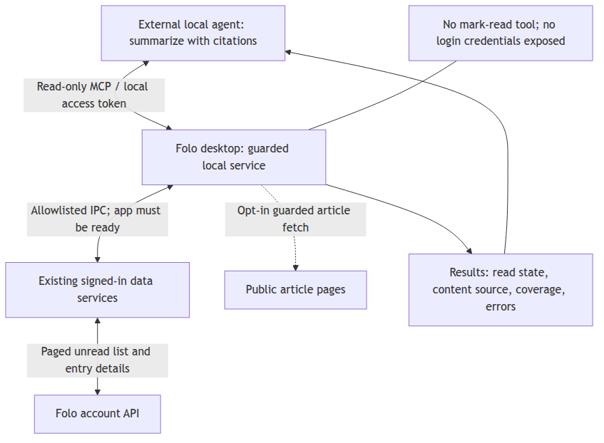

# 外部智能体读取未读文章 — 设计讨论稿

状态：待批准，仅本地记录；没有创建 Chorus 项目、Idea、Proposal 或任务，没有实现接口。
用户已确认：外部本地智能体主动调用；Folo 可保持运行且已登录；暂不写 Chorus。

## 1. 当前能力与缺口

核查时间为 2026-10-20，基于 `dev` 分支 `5e8e0e927`。以下是源码和既有测试文本的静态核对，不是目标桌面产物的运行证明。

- 已读状态已存在：`packages/internal/database/src/schemas/index.ts` 的 `entriesTable.read` 持久化状态；`packages/internal/store/src/modules/unread/store.ts` 的 `markEntriesReadTransaction` / `markEntryUnreadTransaction` 同时维护本地显示、调用远端 API 并通过 `EntryService.patchMany` 落库。
- 未读查询已有客户端入口：`packages/internal/store/src/modules/entry/store.ts` 的 `EntrySyncServices.fetchEntries` 向 `entries.list` / `entries.inbox.list` 传入 `read` 和分页参数；详情与网页正文分别由 `fetchEntryDetail` / `fetchEntryReadabilityContent` 获取。服务端实现及稳定分页语义尚未验证。
- 内置本地 AI 已支持未读筛选：`apps/desktop/layer/renderer/src/modules/ai-chat/utils/local-ai-context.ts` 的 `resolveScopeEntries` 使用 `entry.read === false`。但数据取自 renderer store，而不是全账户分页查询。`LocalAIContextEntry` 本身也没有逐篇 `read` 字段。
- 发送链路 `chat-actions.ts` 的 `createLocalAIContext` 没有先枚举账户全部未读；`takeEntries` 还有条目及文本预算。`local-ai-context.test.ts` 覆盖未读与订阅范围组合，但不是全量远端读取测试。
- 本地数据库不是完整离线镜像：`packages/internal/database/src/services/entry.ts` 的 `getEntriesToHydrate` 按订阅来源保留最新 20 条并清理其余缓存，不能通过直接读库获得全部未读。
- 桌面 `local-ai/article-text.ts` 已有防内网访问的网页提取，包含并发、超时和预算限制；本轮源码中单次最多选择 40 篇补取、总时间预算 45 秒。这些聊天预算不能直接成为批量读取的全量上限。
- 本轮检查的 desktop main IPC、AI 路由、renderer MCP 管理入口及 `tools/ai-gateway/server.mjs` / `README.md` 中，未发现对外提供未读列表与正文的服务。现有 `/ai/*` 网关处理客户端附带的内容；现有 MCP 管理用于连接其他工具，不是 Folo 文章数据服务。

## 2. 候选方案与建议

1. **推荐：桌面内只读 MCP 服务。** 当前应用保管登录状态，外部智能体通过标准工具读取。优点是复用同步和正文能力，不要求智能体理解内部数据库；代价是新增受保护的本机入口和受限 IPC 查询桥。
2. **备选：导出 JSONL/Markdown。** 应用生成未读清单和正文包，智能体读文件。实现简单且便于审计，但不是按需交互，需要重复导出并防止文件过期及隐私残留。
3. **暂不选：独立同步服务或外部直接读 SQLite。** 独立服务重复维护账户与同步；直接读库既有缓存缺失问题，也可能漏掉应用尚未确认的本地操作。对已确认的“允许程序运行”需求没有必要。

首版建议在 Electron 主进程提供本机 Streamable HTTP MCP；通过严格限定操作的 IPC 调用已登录 renderer 的数据服务。renderer 未初始化或已退出时返回 `APP_NOT_READY`，不偷偷创建第二套账户状态。托盘运行是否仍保留可用 renderer 必须实测；首版承诺以实际已就绪状态为准。现有模型网关不承载此入口，也不自动向模型发送文章。

图源为同目录 `access-flow.mmd`；仅描述拟议方案，不表示服务已实现。

## 3. 最小工具契约（拟议名称，不是现有工具）

- `folo_get_status()`：返回服务版本、就绪与登录状态、同步新鲜度、支持范围和批次限制；不返回登录凭据。
- `folo_begin_unread_scan({scope})`：创建绑定当前账户的有界枚举任务，返回 `scanId`。默认范围是账户订阅的全部视图和可访问 Inbox，列表按文章 ID 去重；任何暂不支持的来源必须明示，不能静默排除。可显式收窄到订阅、文件夹或时间范围。
- `folo_list_scan_entries({scanId,cursor,limit})`：分页取得固定候选清单；扫描未结束时返回进度而不是假装完整。每条含 `id,title,url,feedId,publishedAt,readState,readStateObservedAt`，以及正文可用性提示，不在列表中塞入全部正文。
- `folo_get_entry_contents({scanId,entryIds,mode,cursor})`：仅读取该会话允许的 ID，分批返回 Markdown/纯文本。`mode` 区分只取缓存、补取文章详情、以及经授权访问文章源网页；长正文按块继续读取。响应有逐篇错误，不因一篇失败丢掉整批。

建议初值：列表每页 50 条、最多 100 条；正文每批最多 10 篇、网页提取并发 4。限制应可通过状态工具发现，并以字节预算和继续游标保证可读完；不能悄悄取前 N 篇后报成功。初值待实测调整。

## 4. “全部未读”如何成立

先确认账户与同步状态，处理待同步的已读变更；有同步错误时明确暂停或降级。在线分页枚举服务端保留范围内的未读，合并有效本地状态、去重；不能把 UI 当前列表当作候选全集。完成后固定候选 ID 清单，正文读取不再因用户稍后改变阅读状态而漂移。

必须区分两种完整性：`enumerationComplete` 表示已走完支持来源的分页；`selectionConsistency` 表示选集是一致快照还是分页期间的尽力观察。客户端固定 ID 清单不等于拿到“扫描开始那一刻”的原子快照。返回 `startedAt,finishedAt,source,selectionConsistency,enumerationComplete,selectedCount,errors`；远端未提供可信总数时不编造总数。

实现前验证上游分页的边界、同时间戳条目、保留期限和并发读状态变化；若不支持稳定复合游标或快照，首版标为 `best_effort`，显示扫描时间区间。若业务必须精确获取某一时刻的全部未读，则需要服务端快照/游标支持，不能仅在客户端承诺。超出安全容量时明确返回未完成和继续方式，而非静默截断。

离线仅可选择显式的缓存模式，返回 `source=cache,enumerationComplete=false`；空缓存、超时和无权限不能解释为“没有未读”。`readState` 允许 `unknown`，仅确认的未读进入未读选集。会话绑定账户并设过期时间，退出登录、账户切换和服务停用后立即失效；首版重启后重扫，不承诺持久断点。

## 5. 正文与总结责任

优先复用已有正文缓存；缺失则调用文章详情接口。用户允许访问源网页时，复用受保护的 Readability 抓取，逐跳校验地址，禁止私网、环回和元数据地址；不接受任意 URL 抓取参数，也不转发 Folo 登录凭据给文章站点。

每篇返回 `contentSource`（RSS 内容、网页提取或描述摘要）、`fetchStatus`、`fetchedAt`、`truncated`、`nextCursor` 和正文。内容长短、抓取成功都不能证明源站全文完整；完整性无法确定时标记 `unknown`。付费墙、网络失败、无文本、暂不支持的附件/音视频逐项列出，保留可用摘要但不得称为全文。

外部智能体负责分批摘要再汇总，保留文章 ID 与来源链接，报告选中、已处理、仅摘要、失败、未处理的数量。Folo 不替用户选择模型；智能体若调用云端模型仍可能外传正文，本机接口不等于推理全程本地。正文一律视为不可信材料，不能因文内指令启动工具、泄露数据或改变已读状态。

## 6. 权限与副作用

服务默认关闭；用户开启后生成可撤销的专用读取令牌，绑定环回地址，校验 Host/Origin，拒绝未授权浏览器访问，限制连接、速率、正文大小及扫描资源。拒绝通配 CORS，不记录令牌或整篇正文。外部智能体不能通过通用 IPC 调用、SQL 或远端代理接口越权。

首版不注册任何已读写入工具，不走会触发自动标记已读的文章 UI 路径。内容缓存写入与已读写入分开；未来若要“总结后标已读”，另设权限并要求用户明确确认指定 ID，不能将“AI 已处理”等同于“人已阅读”。

## 7. 验收与实施顺序

- [ ] 先通过当前登录环境的只读探针验证：多页未读、相同时间戳、所有视图/Inbox、服务端保留与分页终止条件；记录无法保证的边界。
  - 已做：真实账户多页未读（604 条 / 7 页）、5 个视图全量、分页终止条件（走到空页）。
  - 未做：同时间戳切点（三处注记均为 `page_boundary_unverified`，页内未见同时间戳）、服务端保留期限、Inbox（该账户无 Inbox）、服务端硬上限。
- [ ] 用超过一页且部分从未在 UI 加载的文章，验证分页无静默遗漏、重复 ID 可去重；覆盖空未读、权限错误、离线、限流和扫描中状态变化。
  - 已做：604 条中 583 条无本地正文缓存（不能据此推断从未在 UI 加载），跨页 0 重复 ID、0 未知状态。
  - 未做：空未读账户、权限错误、离线、限流、扫描中状态变化。
- [ ] 验证长正文可完整分块读取，短 RSS、网页失败、非文本内容有明确结果；部分失败仍可继续。
  - 已做：短 RSS（170–913 字符，`length_unknown`）、无缓存条目逐篇 `no_content` 且整批不丢、`detail` 590 字符 `rss`、源页关闭时两种形态都被拒绝。
  - 未做：6000 字符长文续读（抽样文本都很短）、网页失败、非文本内容。
- [ ] 对比实际调用前后的已读状态及同步队列，确认外部读取/总结不改变状态；测试令牌缺失/撤销、恶意 Origin、私网 URL 和账户切换隔离。
  - 已做：读取前后 UI 未读计数（15 徽标 / 总和 334 / 指纹一致）与账户未读 ID 集合（三次完整枚举哈希一致、八次条数一致）不变；无令牌 401、错令牌 401、外来 Origin 403；工具面 4/4 只读、无标记已读工具。
  - 未做：同步队列完整快照（无只读接口）、令牌撤销、私网 URL（工具不接受 URL）、账户切换隔离。
- [ ] 最后从外部智能体连接最终桌面产物，分页读取并生成带覆盖说明和来源的总结；不能以单测或 mock 替代这一步。
  - 已做：官方 MCP 客户端连到最终 AppImage 的解包产物（renderer 来自 `app.asar`），完整分页读取、逐篇标注来源（`rss`）、扫描自带覆盖说明（`partial` + 三个边界原因）。
  - 未做：把它拼成一份“总结”；本次验收的约束是不把文章正文/标题送入模型记录，所以总结生成故意未做。

验收状态：本次真实登录账户验收（§8.6）已完成其中可安全读取的部分；上列每项仍有明确未覆盖的子项，因此勾选框保持未勾。
这些子项需用户/上级确认后再跑（尤其源页开启后的真实抓取），不得用 mock、未登录实例或他人的 profile 代替。
其中两项已不再是待定设计问题，而是已实现并可检查的约束：

- 源页抓取必须经用户单独授权、默认关闭（实现见 §8.5）；未授权时调用被明确拒绝，不做静默降级。
- 同发布时间边界采用保守口径：任何填满一页的切点都使来源降为 `partial`、`enumerationComplete` 为 false，
  并以 `timestamp_tie_boundary` / `page_boundary_unverified` 说明原因；无损判定仍依赖服务端证据，未做客户端猜测。

建议分两步交付：先验证真实分页语义并打通只读 MCP、详情正文和覆盖报告，再补网页正文获取及更长批次的资源控制。两步都不加入已读写操作。实施前仍需用户批准本稿。

初始设计阶段的验证记录：当时只核对源码和既有测试内容，未运行产物或调用账户 API。此记录不代表后续实施状态；实施与验证见 §8，真实账户记录见 §8.6，父级最终核对见 §8.7。

---

## 8. 实施记录（2026-10-20，本地工作区）

用户批准本稿后已实现，未提交、未推送、未部署、未写 Chorus、未改模型或门控配置。基准 `dev@5e8e0e927`。

### 8.1 实际交付

- 主进程：`apps/desktop/layer/main/src/local-agent-reading/`
  - `server.ts`：`127.0.0.1:41610/mcp` Streamable HTTP MCP，四个只读工具；Host/Origin/路径/方法/令牌/体积/速率/并发守卫；无随机端口回退。
  - `service.ts`：工具处理、账户核对（signed-in / signed-out / unknown 三分）、启用/停用、令牌揭示/轮换/撤销、失效广播（丢弃扫描 + 中止在途调用）。
  - `scans.ts`：有界枚举（2000 条、60 s、100/页）、跨页去重、候选钉死、列表分页、15 分钟 TTL、最多 4 个扫描的淘汰。
  - `contents.ts`：正文装配、6000 字符分块与 `c1:` 续读游标、逐篇错误、对已缓存的受保护源页抓取（仅公共 http(s)，逐跳校验）。
  - `provider.ts`：renderer 桥（`requestId` 关联、20 s 超时、取消、账户回显校验）。
  - `token.ts`：`safeStorage` 加密落盘（0600），无 keyring 时明确降级为会话内内存令牌。
  - `account.ts`：`apiClient.auth.getSession()`；仅 401 判为未登录，其余为 `unknown`。
- 共享契约：`packages/internal/shared/src/local-agent-reading.ts`（类型/限制/zod 入参/错误码）与 `bridge.ts` 的 `RenderGlobalContext` 扩展。
- renderer：`apps/desktop/layer/renderer/src/modules/local-agent-reading/` 四方法桥 + 来源计划、分页、正文解析、错误脱敏；`providers/local-agent-reading-provider.tsx` 注册；集成标签页设置区块与 en/zh-CN/ja 文案。
- 设置 IPC：`localAgentReading.{getStatus,setEnabled,revealToken,rotateToken,revokeToken}`，仅主窗口可调用。

### 8.2 实现中发现并修复的缺陷

- **凭据外泄**：账户 SDK 的错误文本内嵌请求头（含会话 `Cookie`），原先会通过 `ACCOUNT_UNAVAILABLE`、
  扫描 `source_failed` 与逐篇 `error.message` 直接呈现给外部智能体。现统一脱敏为
  `The account API answered HTTP <status>` / `The account API request failed`，并有回归测试。
- **release 版 renderer 桥**：`globalThis.__follow` 在 provider 挂载后才存在，端点的就绪判断与 UI 一致性依赖这一点，测试与文档中均已按此顺序等待。

### 8.3 本轮验证（本地）

- typecheck：`@follow/shared`、`@follow/electron-main`、`@follow/web` 全部 0 退出；根 `turbo run typecheck` 22/22。
- 单元测试：主进程 304 个（新增 97 个，含凭据脱敏）、renderer 400 个（新增 45 个）。
- 真实传输：`apps/desktop/e2e/tests/electron/local-agent-reading.spec.ts`（真实 Electron 构建 + 官方 MCP SDK 客户端，
  测试自有 profile）——开关默认关闭、令牌生成/揭示、工具清单只读、`folo_get_status`、未登录时扫描被诚实拒绝、
  无令牌 401、错误令牌 401、Origin 403、外来 Host 403、令牌轮换使旧令牌失效、撤销后仍监听但全拒、关闭后端口关闭。
- 打包产物：`pnpm run build:electron` 成功；`verify:package` 显示 asar 外部依赖全部可解析且包含功能标记；
  `e2e/scripts/check-packaged-local-agent-reading.mjs` 在解包 AppImage 上全部通过（令牌持久化在本机为 `os-keyring`）。

### 8.4 仍未验证（需要真实登录账户）

- 多页未读、相同时间戳边界、服务端保留期限与分页终止条件。
- 正文三分支的实际取值、长文续读、真实站点上的源页抓取结果。
- 调用前后已读状态与同步队列不变（数据库/UI 对照）。
- 已登录状态下的设置页开关与令牌交互（未登录时“集成”标签被登录门禁阻断）。

这些验收项保持未勾选；不得以单元测试、mock 或未登录实例替代。

### 8.5 Review 后修复（同一轮本地工作区）

独立 review 的结论是“可合并但有备注，发布前需修复 P1 与完成 §7 验收”。本轮只做被接受的问题，不重做已交付组件：

- **P1：源页抓取的授权缺失。** 设计稿 §5 要求“用户允许访问源网页时”才抓取，此前主进程无条件抓取。现新增：
  electron-store 键 `localAgentReadingSourcePageEnabled`（未写入即关闭，旧 profile 读为关闭）；
  设置 IPC `localAgentReading.setSourcePageEnabled`（仅主窗口可调）；设置页第二个独立开关与 en/zh-CN/ja 文案；
  `folo_get_status` 与设置状态都返回 `sourcePageEnabled`。
  执行点在主进程 `service.getContents`：以**实际生效模式**（含续读游标携带的模式）判定，未授权时在任何账户请求与
  网页抓取之前返回 `SOURCE_PAGE_DISABLED`；关闭权限只中止在途源页调用，扫描与 `cached`/`detail` 读取不受影响；
  抓取返回后再次核对权限，撤销后抓回的页面不会被返回，改为已存正文加 `source_page_unavailable` 警告。
  任何 MCP 工具都无法授予该权限。
- **P2：分页边界盲区。** 账户游标只有发布时间，无法证明包含语义，因此不再依赖“页内可见同时间戳”才降级：
  任何填满一页的边界都记录到游标状态并使来源 `partial`，从而 `enumerationComplete` 为 false；
  可见同时间戳仍用 `timestamp_tie_boundary`，不可见时用 `page_boundary_unverified`（每来源一次）。
  未分页的短来源、空来源、以及严格低于 `scope.publishedAfter` 的切点不标注；遍历仍尽力走到末尾，不截断。
  未通过 101 行请求或伪造时间戳偏移来“解决”边界语义。
- **P2：每页上限。** `MAX_PAGE_LIMIT` 从 200 改为 100（与应用自身 `Math.min(limit, 100)` 一致），
  避免被服务端截断的答案被读成“来源结束”。
- **P2：未登录期间的拒绝码保真。** 桥接层只要求 `ok: true` 的数据应答回显账户；
  renderer 自己构造的、无账户可回显的拒绝（如退出登录）经形状校验后原样转发，
  不再被改写成 `RENDERER_UNAVAILABLE`；命名了其他账户的拒绝仍为 `ACCOUNT_MISMATCH`，无法识别的拒绝仍被替换。
- **P2：只读守卫。** `failure.ts` 纳入 `readonly.test.ts` 的源码守卫清单。

本轮新增/更新的验证：真实 MCP 传输测试覆盖“源页默认关闭、显式拒绝、续读游标不能绕过、授权后可读、撤销后仍可读已存正文”；
真实 Electron 端到端覆盖两个开关的默认值、互相独立以及工具状态跟随设置；打包产物检查覆盖第二个开关跨重启持久化。
具体命令、退出码与日志路径见本轮集成验证记录（`subagent-artifacts/.../fixes/integration-validation.md`）。

本轮最终状态（本地，1.15.0 Linux x64）：

- 类型检查：根 `turbo run typecheck` 22/22 通过。
- 测试：根 `turbo run test` 12/12 通过（electron-main 327、web 416）；聚焦套件主进程 115、renderer 56。
- 真实 Electron 端到端（`local-agent-reading.spec.ts`，测试自有 profile）通过；解包 AppImage 的
  `check-packaged-local-agent-reading.mjs` 33 项全部通过，含源页权限默认关闭与跨重启持久化。
- 产物：`out/make/Folo-1.15.0-linux-x64.AppImage`
  sha256 `7e43e9222ab5639670fb398a18479b5dbe106c5f03ed53a3162418d653c42670`（144,512,192 B），
  `out/make/deb/x64/Folo-1.15.0-linux-x64.deb`
  sha256 `c43a3e114b372986c8cc7cbfdb7372cbd438239adbe860c0be4f15defb4f14fd`；两者均由同一次
  `pnpm run build:electron` 产出并在此基础上验收。
- 根 `lint`/`format:check` 仍非全绿，原因仅是既有的框架产物：`.pi/subagents/local-agent-reading-flash-workflow.js`
  （解析错误）与 `.pi/subagents/upstream-sync/apk-run-checkpoint.md`（另一个会话的检查点文档），均未改动；
  本次改动的文件全部通过 eslint 与 prettier。

§7 的真实账户验收仍然**未完成**：本次没有使用任何真实登录账户，也没有借用用户正在运行的 Folo profile；
未读分页语义、正文实际取值、源页在真实站点的表现、读取前后已读状态/同步队列不变，仍需人工在自有账户上验收。

### 8.6 真实登录账户验收（2026-10-20，用户批准的独立测试配置）

用户明确批准使用独立测试配置并亲自在该实例中完成登录；本轮只做验收，未改业务代码、未重新构建、未提交、
未部署、未写 Chorus、未换模型。产物与上节同一次构建：AppImage sha256
`7e43e9222ab5639670fb398a18479b5dbe106c5f03ed53a3162418d653c42670`（运行前后一致），运行的是解包产物
`out/verify/appimage/squashfs-root/Folo`（PID 3928091，renderer 实际来自 `resources/app.asar`），
使用新创建的空 profile，未读取或复制任何既有 profile、浏览器资料或 cookie。

**登录与设置路径。** 用应用自身的设置导航打开“设置 → 集成”，以真实指针事件点击标签页与端点开关：
开关从 `false` 变为 `true`，状态随后显示“正在监听 / 令牌已就绪”，端点 `http://127.0.0.1:41610/mcp` 显示，
令牌在界面上保持隐藏（未点“显示”）。`ss` 确认 `127.0.0.1:41610` 处于 LISTEN，未带令牌的请求得到 401。
“允许抓取文章网页”开关全程保持 `false`，未写入该权限（设置存储只新增 `localAgentReadingEnabled: true`）。

**连接与工具面。** 官方 MCP SDK `@modelcontextprotocol/sdk@1.32.1` 的 Streamable HTTP 客户端连上
`http://127.0.0.1:41610/mcp`；专用令牌只在本进程内存中使用，未打印、未落盘、未截图。工具恰好四个，全部
`readOnlyHint`，入参只有 `scope` / `scanId` / `cursor` / `limit` / `entryIds` / `mode`，没有 URL、已读状态
或 `sourcePageEnabled` 参数。

**未读枚举（八次，条数一致）。** `selectedCount` 604，`status=partial`，`enumerationComplete=false`，
`selectionConsistency=best_effort`，`duplicatesRemoved=0`，`unknownReadStateCount=0`；列表分 7 页
（100×6+4），跨页 0 重复 ID，全部 `readState=unread`；21 条有本地正文缓存、583 条没有；缓存缺失不证明此前从未在 UI 加载。
排序后的 ID 集合哈希 `1b61d41264f29127` 在三次完整枚举（两次会话内 + 一次独立复跑）中相同，另五次只核对条数为 604。按来源：view:0 144 条 `partial`、
view:1 414 条 `partial`、view:2 26 条 `complete`、view:3 7 条 `complete`、view:4 13 条 `partial`；
三条 `source_failed` 注记的正文都是 `page_boundary_unverified` 措辞，长度 181 字符，带来源键
（`view:<n>`），不含 URL、不含条目 ID。该账户没有 Inbox，`folo_get_status.unsupportedScopes` 明示搜索结果、
归档/未收藏、账户不再返回的本地缓存三类范围不在覆盖内。

**正文。** `cached` 读 3 条无缓存条目：逐条 `no_content`，整批不丢（`failed: 3`）。`cached` 读 3 条有缓存条目：
3/3 返回，`contentSource=rss`，`completeness=unknown`，`warning=length_unknown`，长度 913 / 230 / 170 字符，
本轮 renderer 网络审计不能观测主进程账户请求，不能据此断言零账户请求。`detail` 读 1 条：590 字符，`contentSource=rss`。抽样文本都没有超过 6000 字符，
**长文续读未触发**，未观察到 `readability` / `description` 取值。

**源页拒绝。** 在源页开关关闭时，显式 `mode: "source_page"` 与 `cursor: "c1:source_page:0:<entryId>"`
（省略 `mode`）都返回 `SOURCE_PAGE_DISABLED` 与文档中的原句，返回条目 0 条。源码中该拒绝发生在账户身份校验之后、正文解析和源网页抓取之前；本轮未审计主进程网络请求，不能声称零账户请求。

**只读不变性。** 读取前后应用自身 UI 的未读计数（15 个徽标、总和 334、指纹 `43f91f80a325498e`、
视图徽标 26/7/13）完全相同；首尾两次完整枚举的未读 ID 集合哈希相同，`disappearedFromUnread=0`、
`appearedInUnread=0`；工具面没有任何写入能力。限制说明：待同步队列的**完整快照未取得**（队列只存在于
renderer 内存 store 与 OPFS 数据库，没有只读接口，读取需要向应用注入代码）；同一份证据覆盖的是“若有待上传的
已读覆盖作用在这 604 条候选上，枚举结果会变化”这一点。另：Electron 下 renderer 的账户请求经主进程
`ipcServices.auth.fetchWithAuth` 发出，因此 CDP 的 `Network` 域看不到这些请求（审计期观察到 0 条），
本轮没有做任何主进程抓包。

**仍未覆盖。** 长文续读、`readability`/`description` 取值、Inbox、按 feed/时间收窄范围、空未读、限流、离线、
扫描中账户切换或退出登录、同步队列快照、服务端保留期限与真实同时间戳切点，以及源页开关开启后的真实抓取
（需用户/上级另行决定）。因此 §7 的勾选框保持未勾，§7 各条下面注明了已完成与未完成的子项。

**过程中的观察（只记录，未改代码）。** view:4 只有 13 条也被标为 `partial`：renderer 的贪婪装页使
`wanted = limit - entries.length`，最后一次调用可能只请求 13 条，而返回正好 13 条会被当作“填满一页”的切点。
这偏向保守（少报完整，不会多报），与文档“填满一页即 partial，即使下一页为空”的措辞一致；若要改成精确判定需要
单独决策。另外，`partial` 来源的逐来源 `error` 字段为 `null`，原因只出现在 `scan.errors` 中，智能体必须读那个数组。

**测试环境留下的状态。** 端点开关保持开启并在监听，令牌存于系统密钥串；登录会话、阅读状态、源页开关（关闭）、
系统 MIME 关联已核对为原来的 `folo.desktop`；业务代码未改动，仅更新本地验收文档。`git status` 条目相同不能证明未跟踪文件内容不变。完整证据与脚本见本轮 live acceptance 报告。

### 8.7 父级核对与备注处置（2026-10-20）

父级核对了脱敏原始 JSON、实际测试日志和最终 AppImage 哈希。真实账户核心流程已验证，但不将 604 条候选称为账户未读全集，也不将界面计数或未读集合未变扩展为同步队列完整快照未变。未生成文章总结，未向模型传入正文。

- `pnpm exec turbo run typecheck`、`lint`、`test` 与 `git diff --check` 均退出 0。日志分别为 `/tmp/folo-parent-final-typecheck.log`、`/tmp/folo-parent-final-lint.log`、`/tmp/folo-parent-final-test.log`。
- `format:check` 退出 1，仅剩另一个会话的 `.pi/subagents/upstream-sync/apk-run-checkpoint.md`，未擅自修改。日志 `/tmp/folo-parent-final-format.log`。
- 本任务父代理创建的原始 workflow 脚本曾导致根 lint 解析错误；已获用户授权，经 `dcg allow-once` 单次放行移至本次会话产物目录，未修改全局安全规则。这不是项目原有缺陷。
- 非阻塞备注 1：工具描述未写源页授权句。暂不修改；实际工具状态提供 `sourcePageEnabled`、拒绝返回 `SOURCE_PAGE_DISABLED`，用户文档已说明。后续改动该描述时可补充。
- 非阻塞备注 2：扫描层把分页边界注记映射为 `source_failed`，把中途退出登录映射为 `provider_unavailable`。暂保留现有错误契约；消息保留原因，`partial` 与完整性字段明确，文档已披露，不影响拒绝访问或覆盖判断。
- 非阻塞备注 3：源页失败会覆盖单个 warning 字段中的此前警告。暂不扩展返回结构；`completeness` 仍独立保留，调用方不能把 fallback 正文当成完整源文。
- 小来源也可能因装页剩余容量而被保守标为 `partial`。这是低估完整性而非假称完整；本轮保留并披露，不为消除提示而放松边界。
- 完整验收仍未完成：具体未覆盖项见 §8.6。后续无需重复已验证路径，优先补长文、Inbox、同步队列观测及获授权后的源页抓取。
